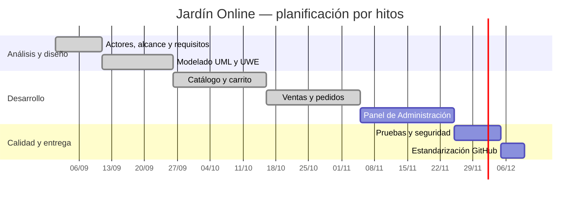

# Diagrama de Gantt (plan referencial)

Este cronograma representa el orden y las dependencias de trabajo, no fechas reales. Ajustar los periodos cuando el equipo confirme su calendario.

**Importante:** las fechas incluidas son una representación provisional para que Mermaid pueda dibujar el Gantt; no constituyen fechas confirmadas del equipo. Reemplazarlas por el calendario real antes de presentar.
